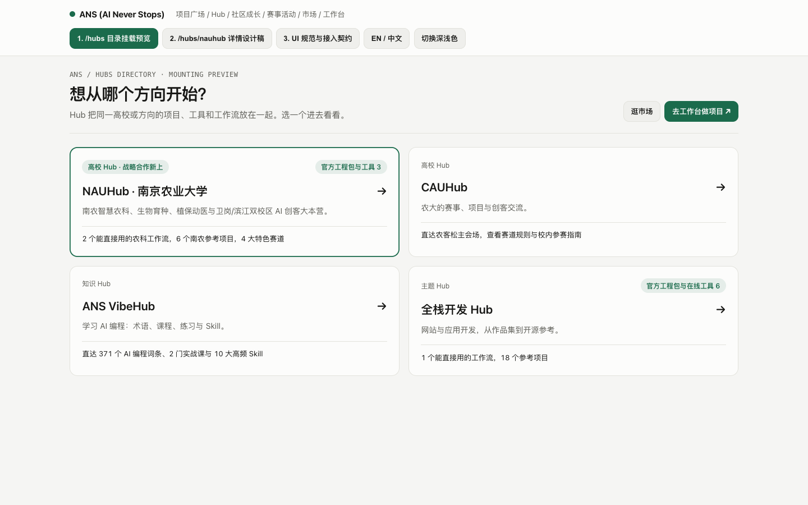
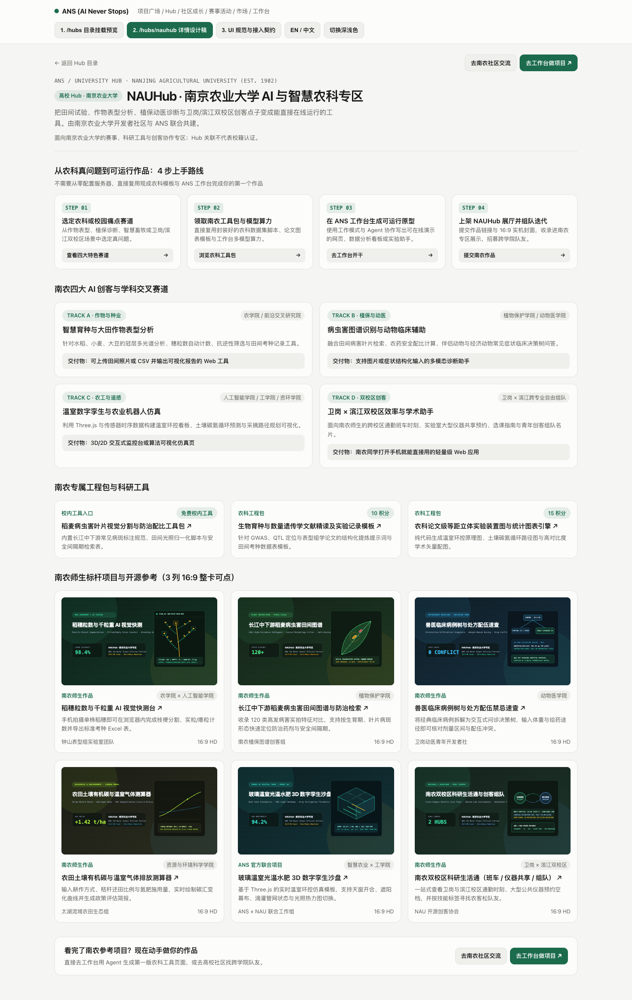
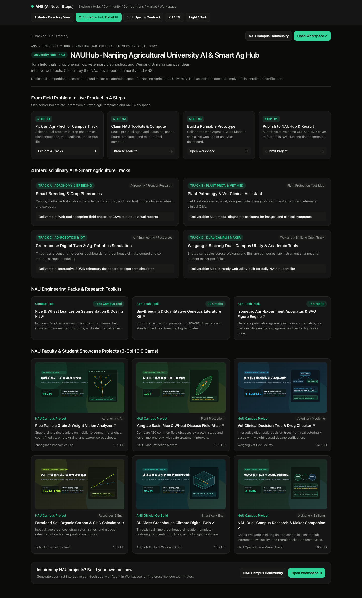
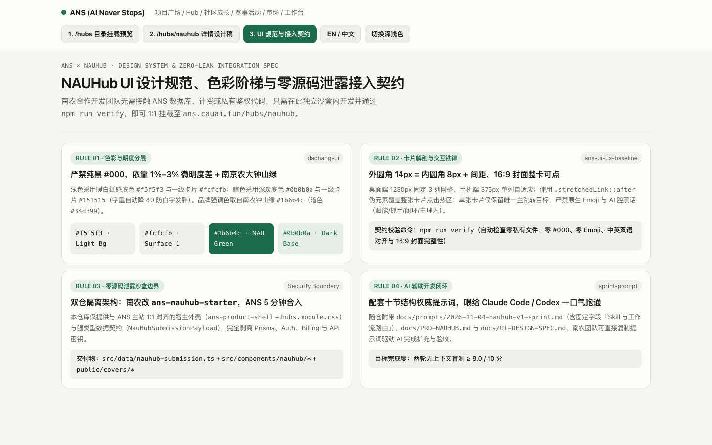

# ANS × 南京农业大学 `NAUHub` 官方联合开发脚手架 (`ans-nauhub-starter`)

欢迎来到 **ANS (AI Never Stops，`https://ans.cauai.fun`) × 南京农业大学 (Nanjing Agricultural University, NAU)** 联合开发仓库！

- **飞书在线联合开发全案手册（含 PRD + UI 设计稿大图 + 冲刺 Prompt）**：[https://narcb9vct6.feishu.cn/wiki/CkunwgTraiqXDSkdDPnctcLbnbe](https://narcb9vct6.feishu.cn/wiki/CkunwgTraiqXDSkdDPnctcLbnbe)
- **GitHub 公开脱敏脚手架仓库**：[https://github.com/1008611-creater/ans-nauhub-starter](https://github.com/1008611-creater/ans-nauhub-starter)

本仓库为南农合作开发团队提供 **100% 脱敏、开箱即用** 的 `NAUHub`（`/hubs/nauhub`）前端沙盒环境、TypeScript 接入契约、大厂级 UI 设计稿以及可直接喂给 Claude Code / Codex / Cursor 的 **十节结构权威开发提示词（`sprint-prompt`）**。

---

## 一、核心交付物快速导航

| 模块 | 文件路径 | 用途说明 |
| :--- | :--- | :--- |
| **1. 权威开发提示词 (`sprint-prompt`)** | [`docs/prompts/2026-11-04-nauhub-v1-sprint.md`](docs/prompts/2026-11-04-nauhub-v1-sprint.md) | **直接复制喂给 Claude Code / Codex / Cursor**，按十节结构与 Skill 路由一口气完成 NAUHub 开发与自测 |
| **2. 产品需求文档 (PRD) 与接入契约** | [`docs/PRD-NAUHUB.md`](docs/PRD-NAUHUB.md) | 定义 NAUHub 7 大核心页面模块、四大农科赛道、双仓隔离安全边界与 5 分钟合入主站流程 |
| **3. UI/UX 视觉设计稿与规范说明书** | [`docs/UI-DESIGN-SPEC.md`](docs/UI-DESIGN-SPEC.md) | 含浅色/暗色/中英双语实机设计稿大图、`dachang-ui` 色彩变量表与卡片解剖规范 |
| **4. 零依赖即时交互设计稿** | [`public/ui-design-mockup.html`](public/ui-design-mockup.html) | 双击或运行 `npm run preview:mockup` 即可在浏览器切换目录挂载、详情页、深浅色与中英文 |
| **5. ANS 主站公开接入契约** | [`src/contracts/ans-hub-contract.ts`](src/contracts/ans-hub-contract.ts) | 与 ANS 主站 `src/domain/hubs/registry.ts` 1:1 对齐的 TypeScript 强类型定义 |
| **6. 南农数据包与双语配置** | [`src/data/nauhub-submission.ts`](src/data/nauhub-submission.ts) | **南农团队核心维护文件**：收录赛道、工程包、师生项目卡片与 `zh/en` 双语词条 |
| **7. Next.js 交互工作台组件** | [`src/components/nauhub/nauhub-workbench.tsx`](src/components/nauhub/nauhub-workbench.tsx) | 完整可运行的 React 组件，支持学院筛选、深浅色与三视图切换 |
| **8. 自动化契约与基线门禁** | [`scripts/verify-nauhub.mjs`](scripts/verify-nauhub.mjs) | 运行 `npm run verify` 一键校验零私有代码、零 `#000`、零原生 Emoji、双语对齐与封面完整性 |

---

## 二、UI 设计稿实机预览

### 1. ANS `/hubs` 目录页挂载效果（浅色模式）


### 2. `/hubs/nauhub` 南京农业大学专区完整设计稿（浅色中文）


### 3. `/hubs/nauhub` 暗色模式与全英文国际化状态（Dark Mode · EN）


### 4. UI 视觉规范与零源码泄露接入契约面板


---

## 三、30 秒快速上手指南

### 方式 A：免安装直接预览交互式 UI 设计稿
```bash
git clone https://github.com/1008611-creater/ans-nauhub-starter.git
cd ans-nauhub-starter
npm run preview:mockup
# 浏览器打开 http://127.0.0.1:3457/ui-design-mockup.html
```

### 方式 B：启动 Next.js 15 完整开发环境 + 用 AI 推进开发
```bash
npm install
npm run dev
# 浏览器访问 http://localhost:3456
```

**使用 AI 编码助手（Claude Code / Codex / Cursor）一键开发：**
1. 在终端打开本项目目录，启动 Claude Code 或 Codex；
2. 将 [`docs/prompts/2026-11-04-nauhub-v1-sprint.md`](docs/prompts/2026-11-04-nauhub-v1-sprint.md) 全文复制发送给 AI；
3. 开发完成后运行门禁自检：
```bash
npm run verify
npm run typecheck
```
4. 当终端输出 `✅ ANS × NAUHub 接入契约与 UI 基线核验全部通过 (ALL PASS)` 后，直接提交 Pull Request，ANS 主站团队将在 5 分钟内将您的改动合入 `https://ans.cauai.fun/hubs/nauhub`！

---

## 四、安全与合规说明
- **零源码泄露架构**：本仓库仅包含 ANS 公开前端宿主外壳（`ans-product-shell` + `hubs.module.css`）与 TypeScript 数据契约，不包含任何 ANS 后端数据库、用户鉴权或计费私有代码。
- **高校专区免责声明**：`NAUHub` 为面向南京农业大学师生的赛事、科研工具与创客协作专区；Hub 关联不代表官方校籍认证。
